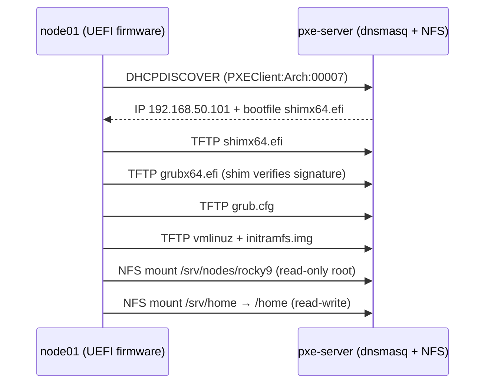

# Diskless PXE-Booted HPC Node — From Windows Lab PC to Linux Compute Node

Turning a Windows student-lab PC into a **diskless Linux compute node** that boots over the network from a server VM on a laptop — **without touching the PC's Windows installation or disk** — then benchmarking it (network, boot, NFS storage, HPL) with two different network adapters.

This is Phase 1 of a larger goal: a PXE-booted HPC cluster built from ~10 Windows lab PCs, used for MPI and HPL benchmarking.

> Claims in this document are labelled where it matters: **(Fact)** = documented/verified, **(Inference)** = reasoned from evidence, **(Guess)** = plausible but unproven.

---

## Table of Contents

1. [Results at a glance](#1-results-at-a-glance)
2. [Concepts (simple version)](#2-concepts-simple-version)
3. [Lab survey and design decisions](#3-lab-survey-and-design-decisions)
4. [Architecture](#4-architecture)
5. [Phase 1 — Server VM](#5-phase-1--server-vm)
6. [Step 0 — Private network IP](#6-step-0--private-network-ip)
7. [Step 1 — DHCP + TFTP with dnsmasq](#7-step-1--dhcp--tftp-with-dnsmasq)
8. [Step 2 — Prove we control GRUB](#8-step-2--prove-we-control-grub)
9. [Step 3 — Build the diskless OS image](#9-step-3--build-the-diskless-os-image)
10. [Phase B — Read-only shared image + persistent /home](#10-phase-b--read-only-shared-image--persistent-home)
11. [Step 4 — Node identity and robust dnsmasq](#11-step-4--node-identity-and-robust-dnsmasq)
12. [Step 5 — MPI stack, SSH, tools](#12-step-5--mpi-stack-ssh-tools)
13. [Benchmarks — Corechip (100 Mb) vs ASIX (1 Gb)](#13-benchmarks--corechip-100-mb-vs-asix-1-gb)
14. [Troubleshooting log (every error, cause, fix)](#14-troubleshooting-log-every-error-cause-fix)
15. [Final configuration files](#15-final-configuration-files)
16. [Maintenance — updating the image](#16-maintenance--updating-the-image)
17. [Lessons learned](#17-lessons-learned)
18. [Next steps](#18-next-steps)

---

## 1. Results at a glance

**Node:** Dell OptiPlex 5080 (i7-10700, 8C/16T, 16 GB) booted diskless as `node01`, Rocky Linux 9.8, root filesystem over NFS.

| Test | Corechip SR9900 (USB, 100 Mb) | ASIX USB-to-Gigabit | Gain |
|---|---|---|---|
| Link speed | 100 Mb/s | **1000 Mb/s** | 10× |
| iperf3 node → server | 93.4 Mbit/s | **923 Mbit/s** | 9.9× |
| iperf3 server → node | 94.1 Mbit/s | **875 Mbit/s** | 9.3× |
| Boot time (GRUB → login prompt) | 124.6 s | **53 s** | 2.4× |
| `systemd-analyze` (kernel+initrd+userspace) | 20.3 s | **12.5 s** | 1.6× |
| NFS write (500 MiB, fsync) | 11.7 MB/s | **110 MB/s** | 9.4× |
| NFS read (500 MiB, caches dropped) | 11.8 MB/s | **76.4 MB/s** | 6.5× |
| HPL (N=40512, NB=192, 2×4) — *control* | 250.01 GFLOPS | 249.57 GFLOPS | ≈ same |

**HPL on node01:** ~250 GFLOPS, PASSED. CPU measured at **~3.58 GHz, pinned at 64.9 W** (its 65 W power limit) during the run → real-clock Rpeak 457.6 GFLOPS → **54.5% efficiency**.

---

## 2. Concepts (simple version)

### What we are doing

Make a lab PC run Linux that **lives on a server**, loaded over a network cable at boot — without using the PC's own disk.

**Analogy:** a normal install is like *copying a movie to your phone*. PXE/diskless boot is like *streaming it*. When you stop streaming, nothing was saved on the phone — reboot the PC without the cable and Windows starts exactly as before.

### Why real HPC clusters do this

(Fact) Large clusters have hundreds/thousands of compute nodes. Admins do not install an OS on each; tools like **xCAT** and **Warewulf** boot nodes from one image on a central server.

- Update the image once → reboot → every node is updated.
- A node dies → replace hardware → it boots the same image.

### The use case

- **Daytime:** students use the lab PCs with Windows, as normal.
- **Evening:** connect cables, press F12 on each PC → a Linux HPC cluster in minutes → run MPI/HPL.
- **Next morning:** normal reboot → Windows. Nothing on the students' PCs changed.

### What happens when a node boots

| Step | The PC asks… | The server answers with | Service |
|---|---|---|---|
| 1 | "Who am I? What should I boot?" | An IP address + boot file name | **DHCP** (dnsmasq) |
| 2 | "Give me the boot file" | `shimx64.efi` → `grubx64.efi` (signed → Secure Boot accepts) | **TFTP** (dnsmasq) |
| 3 | "Give me Linux" | Kernel + initramfs | **TFTP** |
| 4 | "Where is my full system?" | The OS folder, shared over the network | **NFS** root |

PXE runs in the **network card's firmware, before Windows loads** — so nothing needs to be configured on the client. DHCP hands out the IP.

### Where the data lives

| What | Physically stored | After reboot |
|---|---|---|
| OS files (`/usr`, `/bin`, programs) | Server, NFS, **read-only** | Still there |
| Temporary files (`/tmp`, `/var/log`, runtime state) | Node **RAM** (tmpfs) | **Erased** (clean, identical nodes) |
| User work (`/home`) | Server, NFS, **writable** | **Saved** |

The node's own disk is **never mounted or written**. Linux can *see* it (`lsblk`), but we never touch it.

(Inference) Consequence: the server (here, a VM on a laptop's `S:` drive) becomes the most important machine — back up the VM folder.

This mirrors real clusters (Fact): compute nodes are *stateless*; `/home` is on shared storage (NFS on small clusters, Lustre/GPFS on large ones).

---

## 3. Lab survey and design decisions

### Lab PCs surveyed (via `msinfo32` and boot menus)

| PC | CPU | RAM | Boot | Secure Boot | PXE entry in boot menu |
|---|---|---|---|---|---|
| HP ProOne 240 G10 AIO | i5-1335U, 10C/12T (2P+8E), 15 W | 16 GB | UEFI (AMI F.30) | Off | **Not shown** (network boot likely disabled in BIOS) |
| HP EliteDesk 800 G5 TWR | i7-9700K, 8C/8T | 8 GB | UEFI | On | Yes — Intel I219-LM IPv4/IPv6 |
| **Dell OptiPlex 5080** | **i7-10700, 8C/16T** | **16 GB** | UEFI | **On** | Yes — Onboard NIC IPv4/IPv6 |

Observations:
- **All UEFI** → UEFI PXE boot files (shim/GRUB), not legacy `pxelinux`.
- **Secure Boot on** for 2 of 3 → do **not** disable it; boot through the **signed shim → GRUB → kernel chain** that Rocky ships. (Fact) Secure Boot then accepts the network boot with no BIOS change.
- Mixed CPU generations and 8/16 GB RAM → a heterogeneous cluster; for multi-node HPL, the smallest-RAM node limits N.
- The Dell's boot list showed "Ubuntu" entries → Linux was installed at some point (unknown; ask the lab admin; never select them).
- Lab network: `10.252.12.0/23`, gateway `10.252.12.1`, existing DHCP server.

### Safety rules adopted

- **BitLocker:** (Fact) changing Secure Boot/BIOS settings can make Windows demand the 48-digit recovery key at next boot. Check with `manage-bde -status C:`, get recovery keys from the admin **before** touching any BIOS setting. Choosing PXE from the **one-time F12 boot menu** changes no settings.
- **Never change permanent boot order.** Use the one-time boot menu.
- **Never run anything against the node's local disk.**

### Network decision: isolated cable instead of the lab LAN

Running DHCP on the shared lab LAN risks conflicting with the existing DHCP server (would need *proxyDHCP*, and switches with DHCP snooping may block it).

**Decision:** connect the laptop **directly** to the Dell with one LAN cable — a private, isolated network:
- zero risk to the lab network, no admin involvement needed
- our server can be the **only** DHCP server (plain DHCP, simpler than proxyDHCP)
- (Fact) modern NICs auto-detect a direct cable; any normal LAN cable works
- laptop keeps **Wi-Fi for internet**, cable for PXE

(Adding more nodes later needs a small switch, since the laptop has one Ethernet port.)

---

## 4. Architecture

```
 Wi-Fi (internet) ── Laptop (Windows 11, VMware Workstation 17.6.3)
                        │
                        └── VM "pxe-server" (Rocky Linux 9)
                              ens160: NAT      → internet for dnf (192.168.207.0/24)
                              ens192: Bridged  → laptop's wired USB adapter
                                                 192.168.50.1/24
                        │
                     LAN cable (private network 192.168.50.0/24)
                        │
                    Dell OptiPlex 5080 = node01 (192.168.50.101)
                    PXE → shim → GRUB → kernel → NFS root
                    (local disk never touched)
```



**Why two NICs on the server:** one for the internet (NAT), one for the private cluster network. Keeping them separate also guarantees our DHCP server can never leak onto the lab or internet side.

`192.168.50.0/24` was chosen after checking `ipconfig`: none of the existing VMware networks (192.168.11/207/242/146.x, 10.0.0.0/16) or the lab subnet use it.

---

## 5. Phase 1 — Server VM

**Laptop:** i5-1235U, 16 GB, Windows 11, VMware Workstation 17 Pro 17.6.3, ~34 GB free on `S:`.

1. Connect the LAN cable: laptop wired adapter ↔ Dell LAN port.
2. Download the Rocky Linux 9 **minimal** ISO.
3. **VMware → Edit → Virtual Network Editor → Change Settings → VMnet0 (Bridged)** → "Bridged to": select the **wired adapter specifically** (not *Automatic* — it may pick Wi-Fi).
4. Create VM: 2 vCPU, 4 GB RAM, 30 GB disk (not preallocated).
   - Network Adapter 1: **NAT**
   - Network Adapter 2: **Custom → VMnet0**
5. Install Rocky minimal; during install enable only NIC1 (NAT).

Verify:
```bash
ip -br addr
# ens160 UP 192.168.207.169/24   (NAT)
# ens192 UP (no IPv4 yet)        (private)
```

---

## 6. Step 0 — Private network IP

```bash
sudo nmcli con show
sudo nmcli con mod ens192 \
  ipv4.method manual \
  ipv4.addresses 192.168.50.1/24 \
  ipv4.gateway "" \
  ipv4.dns "" \
  ipv6.method disabled \
  connection.autoconnect yes
sudo nmcli con up ens192
```

Why:
- **Fixed IP:** the server is the "boss" of the private network; nodes must always find it.
- **No gateway on ens192:** a gateway means "send internet traffic this way". On ens192 it could hijack the default route → internet traffic sent to the Dell (which has no internet) → `dnf` breaks.
- **No DNS:** same reason.

Verify:
```bash
ip -br addr        # ens192 = 192.168.50.1/24
ip route           # exactly ONE default route, via ens160
ping -c 2 rockylinux.org
```
```
default via 192.168.207.2 dev ens160 proto dhcp src 192.168.207.169 metric 100
192.168.50.0/24 dev ens192 proto kernel scope link src 192.168.50.1
192.168.207.0/24 dev ens160 proto kernel scope link src 192.168.207.169 metric 100
```

The line `192.168.50.0/24 dev ens192 scope link` is a **route**: "any address 192.168.50.0–255 is directly on the cable of ens192; no gateway needed". (It is *not* the broadcast address — that is `192.168.50.255`.)

---

## 7. Step 1 — DHCP + TFTP with dnsmasq

### 7a. Install, trust the private interface

```bash
sudo dnf install -y dnsmasq
sudo nmcli con mod ens192 connection.zone trusted
sudo nmcli con up ens192
```
The `trusted` firewall zone allows everything **on the private cable only**; the NAT side stays protected. (Fact) Real clusters commonly trust their internal provisioning network.

### 7b. Signed boot files (without touching the server's own boot setup)

```bash
mkdir ~/efi && cd ~/efi
dnf download shim-x64 grub2-efi-x64
#   shim-x64-16.1-2.el9.x86_64.rpm
#   grub2-efi-x64-2.06-126.el9_8.rocky.0.3.x86_64.rpm
for f in *.rpm; do rpm2cpio "$f" | cpio -idm; done
find . -name "*.efi"
#   ./boot/efi/EFI/rocky/{grubx64.efi, mmx64.efi, shim.efi, shimx64-rocky.efi, shimx64.efi}
#   ./boot/efi/EFI/BOOT/fbx64.efi
sudo mkdir -p /var/lib/tftpboot
sudo cp ./boot/efi/EFI/rocky/shimx64.efi ./boot/efi/EFI/rocky/grubx64.efi /var/lib/tftpboot/
sudo restorecon -Rv /var/lib/tftpboot
sudo chmod 644 /var/lib/tftpboot/*.efi
ls -lZ /var/lib/tftpboot/
```
Expected label `tftpdir_rw_t`, mode `rw-r--r--`.

- `/var/lib/tftpboot` does not exist by default — (Fact) it's normally created by the `tftp-server` package, which we don't use (dnsmasq has TFTP built in).
- `restorecon`: a directory created by hand inherits its parent's generic `var_lib_t` label, and so do files copied into it. `restorecon` applies the correct label from SELinux's rules.
- `chmod 644`: the extracted files were `rwx------` (root only); (Fact) dnsmasq's TFTP drops privileges and runs as user `dnsmasq`.

### 7c. dnsmasq configuration

`sudo vim /etc/dnsmasq.d/pxe.conf` (initial version):
```
interface=ens192
bind-interfaces
port=0
dhcp-range=192.168.50.100,192.168.50.200,255.255.255.0,12h
dhcp-match=set:efi64,option:client-arch,7
dhcp-match=set:efi64,option:client-arch,9
dhcp-boot=tag:efi64,shimx64.efi
enable-tftp
tftp-root=/var/lib/tftpboot
log-dhcp
```

| Line | Meaning |
|---|---|
| `interface` / `bind-interfaces` | Serve **only** on the private cable, never on NAT |
| `port=0` | Disable dnsmasq's DNS server — we only want DHCP + TFTP |
| `dhcp-range` | Hand out IPs .100–.200 |
| `dhcp-match … 7 / 9` | Recognise "I am a 64-bit UEFI PC" (client architecture option 93) |
| `dhcp-boot` | Tell those PCs: download `shimx64.efi` |
| `enable-tftp` / `tftp-root` | Serve files from this folder |
| `log-dhcp` | Log the full DHCP conversation |

```bash
grep conf-dir /etc/dnsmasq.conf      # conf-dir=/etc/dnsmasq.d,.rpmnew,.rpmsave,.rpmorig
sudo dnsmasq --test                  # dnsmasq: syntax check OK.
sudo systemctl enable --now dnsmasq
sudo journalctl -fu dnsmasq
```
Startup log must show:
```
started, version 2.85 DNS disabled
DHCP, IP range 192.168.50.100 -- 192.168.50.200, lease time 12h
DHCP, sockets bound exclusively to interface ens192
TFTP root is /var/lib/tftpboot
```

Later additions (see troubleshooting #6 and Step 4):
```
dhcp-option=3                         # advertise NO gateway to anyone
dhcp-host=68:e4:3b:30:89:ad,ignore    # laptop Windows (Corechip adapter)
dhcp-host=7c:c2:c6:4e:20:01,ignore    # laptop Windows (ASIX adapter)
```

### 7d. First PXE boot

Dell: power on → **F12** → **Onboard NIC (IPv4)**. No client configuration needed — PXE runs in firmware before Windows.

Reading the log:

| Log line | Meaning |
|---|---|
| `vendor class: PXEClient:Arch:00007:UNDI:003016` + `tags: efi64, ens192` | Real UEFI PXE firmware; matched our `dhcp-match` |
| `bootfile-name shimx64.efi` | Server told it what to download |
| `error 8 User aborted the transfer` then `sent shimx64.efi` | Normal (Fact): UEFI first requests the file *size*, aborts, then downloads |
| `revocations_sku.efi / revocations_sbat.efi / shim_certificate_0.efi not found` | Optional files newer shim probes for; harmless (Inference) |
| **`sent grubx64.efi`** | **Secure Boot accepted shim** — (Fact) shim only fetches GRUB after firmware verified it |
| `grub.cfg-01-b0-7b-25-03-5c-c3`, `grub.cfg-C0A832B2` … `grub.cfg` not found | GRUB searching for its config |

**GRUB's config search order** (a key cluster concept — per-node boot configs):
1. `grub.cfg-01-<MAC>` — this exact PC
2. `grub.cfg-<IP in hex>` then shorter prefixes — `C0A832B2` = 192.168.50.178; shorter = whole ranges
3. `grub.cfg` — default for everyone
4. Then the same under `EFI/rocky/`, then module lists `EFI/rocky/x86_64-efi/*.lst`

GRUB told us where to put the config — no guessing. The Dell stopped at a `grub>` prompt (expected).

---

## 8. Step 2 — Prove we control GRUB

`sudo vim /var/lib/tftpboot/grub.cfg`:
```
set timeout=15
menuentry 'Test: hello from pxe-server' {
    echo 'GRUB was loaded over the network from 192.168.50.1'
    sleep 10
}
menuentry 'Exit (back to firmware / Windows)' {
    exit
}
```
- New files in the folder inherit `tftpdir_rw_t` (folder already labelled) — no `restorecon` needed.
- (Fact) GRUB `exit` in UEFI returns control to the firmware.

Result: our menu appeared; the test entry printed the message with the server IP. "Exit" led to a Dell "scanning" screen — (Inference) firmware moving to the next one-time boot option (IPv6 PXE / diagnostics); harmless.

---

## 9. Step 3 — Build the diskless OS image

Method: **Red Hat's documented remote diskless system** — (Fact) install a full system into a folder with `--installroot`, build an initramfs with `dracut --add nfs`, boot with `root=nfs:server-ip:/exported/root/directory`. Red Hat's method mounts root **read-write** (fine for one node); Phase B later makes it read-only and shareable.

### 3a. Install an OS into a folder

```bash
sudo dnf install -y nfs-utils
sudo mkdir -p /srv/nodes/rocky9
sudo dnf install -y --installroot=/srv/nodes/rocky9 --releasever=/ \
    @core kernel dracut-network nfs-utils
```
`--installroot` installs a whole OS into a folder instead of `/`. `--releasever=/` takes the release version from the host.

**Root password for the image** — see troubleshooting #8 (both `passwd` and `usermod -R` failed due to SELinux). Working method:
```bash
HASH=$(openssl passwd -6)                         # SHA-512 crypt hash
sudo sed -i "s|^root:[^:]*:|root:${HASH}:|" /srv/nodes/rocky9/etc/shadow
sudo grep '^root' /srv/nodes/rocky9/etc/shadow | cut -c1-15     # root:$6$...
```
(`root:*` = no password, account locked — the node would be unusable.)

### 3b. initramfs that works on *any* hardware

```bash
ls /srv/nodes/rocky9/lib/modules/        # 5.14.0-687.54.1.el9_8.x86_64
KVER=5.14.0-687.54.1.el9_8.x86_64
for d in dev proc sys; do sudo mount --bind /$d /srv/nodes/rocky9/$d; done
sudo chroot /srv/nodes/rocky9 dracut -f --no-hostonly --add nfs /boot/initramfs-$KVER.img $KVER
for d in dev proc sys; do sudo umount /srv/nodes/rocky9/$d; done
```
**`--no-hostonly` is critical:** by default dracut includes only drivers for the machine it runs on — here the **VM**, with VMware's NIC. (Inference) Without it, the Dell's Intel NIC driver (`e1000e`) would be missing and it could never reach the server to mount root. Classic diskless trap.

### 3c. Kernel + initramfs to TFTP

```bash
sudo cp /srv/nodes/rocky9/boot/vmlinuz-$KVER /var/lib/tftpboot/vmlinuz
sudo cp /srv/nodes/rocky9/boot/initramfs-$KVER.img /var/lib/tftpboot/initramfs.img
sudo chmod 644 /var/lib/tftpboot/vmlinuz /var/lib/tftpboot/initramfs.img
ls -lhZ /var/lib/tftpboot/          # initramfs.img = 87 MB
```
(Fact) dracut creates the initramfs readable by root only — same permission trap as the EFI files.

### 3d. Export over NFS

`/etc/exports` (Step 3 version):
```
/srv/nodes/rocky9 192.168.50.0/24(rw,sync,no_root_squash)
```
```bash
sudo systemctl enable --now nfs-server
sudo exportfs -v
```
`no_root_squash` (Fact): normally NFS maps a client's root to a powerless user. A diskless node's root *is* the system, so it needs real root rights over its own files.

### 3e. Boot entry

Added to `grub.cfg` above Exit:
```
menuentry 'Rocky 9 diskless (NFS root)' {
    linux /vmlinuz root=nfs:192.168.50.1:/srv/nodes/rocky9 rw ip=dhcp selinux=0
    initrd /initramfs.img
}
```
`selinux=0`: Red Hat's diskless guide states SELinux must be disabled on clients using NFS as root filesystem. (Inference) NFS doesn't carry the labels SELinux needs. Server keeps SELinux enforcing.

### 3f. Result

```
Rocky Linux 9.8 (Blue Onyx)
Kernel 5.14.0-687.54.1.el9_8.x86_64 on x86_64
[root@localhost ~]# hostname -I
192.168.50.178
[root@localhost ~]# findmnt /
/  192.168.50.1:/srv/nodes/rocky9  nfs4  rw,relatime,vers=4.2,...,proto=tcp,...
[root@localhost ~]# lsblk
sda  8:0  0  931.5G  0  disk
```
- Booted from our image, IP from our dnsmasq, root over **NFS 4.2**.
- Login as `sanket` failed: that user existed on the server, not in the image (→ UID consistency, Phase B).
- `lsblk`: only a 931.5 GB `sda` with no partitions listed. (Guess) Windows may be on an NVMe drive hidden by Dell's "RAID On"/Intel RST storage mode; `sda` may be a second disk. Unknown — **never touch it**; ask the admin.

---

## 10. Phase B — Read-only shared image + persistent /home

**Goal:** with two nodes writing into one shared image they would corrupt each other. After Phase B: image **read-only** for all nodes; each node's writable bits in **its own RAM**; `/home` on the server, writable and persistent.

Method (Fact, RHEL "Setting read-only permissions for the root file system"): `readonly-root` package, `READONLY=yes` in `/etc/sysconfig/readonly-root`, boot with `ro`; paths listed in `/etc/rwtab` (+ `/etc/rwtab.d/`) get writable tmpfs copies; changes are lost at reboot.

**Order matters:** create the user while the node is still writable, lock the image afterwards.

### B1. Shared /home on the server

```bash
id sanket                                   # uid=1000 gid=1000
sudo mkdir -p /srv/home/sanket
sudo cp -r /etc/skel/. /srv/home/sanket/
sudo chown -R 1000:1000 /srv/home/sanket
sudo chmod 700 /srv/home/sanket
```
`/etc/exports` add:
```
/srv/home 192.168.50.0/24(rw,sync)
```
```bash
sudo exportfs -ra && sudo exportfs -v
```
No `no_root_squash` here on purpose: node root has no business owning users' files, so default root squashing stays on.

### B2. On the node (still writable): matching user

```bash
groupadd -g 1000 sanket
useradd -u 1000 -g 1000 -M -d /home/sanket -G wheel sanket
passwd sanket
```
- **Same UID/GID as on the server** → files in `/home/sanket` belong to the same person everywhere.
- `-M`: no home in the image; it comes from the server.
- `passwd` works here: SELinux is off on the node.

### B3. On the server: read-only-ready image

```bash
sudo dnf install -y --installroot=/srv/nodes/rocky9 --releasever=/ readonly-root
ls /srv/nodes/rocky9/etc/rwtab /srv/nodes/rocky9/etc/sysconfig/readonly-root
sudo vim /srv/nodes/rocky9/etc/sysconfig/readonly-root        # READONLY=yes
sudo truncate -s 0 /srv/nodes/rocky9/etc/machine-id
```
**Empty `machine-id`** (multi-node critical): every system has a unique ID in `/etc/machine-id`. With a shared image all nodes would share one ID, and NetworkManager uses it for its DHCP identity → (Inference) two nodes could fight over one IP. (Fact) With an empty file on a read-only root, systemd generates a fresh transient ID each boot.

`/srv/nodes/rocky9/etc/fstab` add:
```
192.168.50.1:/srv/home  /home  nfs  defaults,_netdev  0 0
```
`_netdev`: mount only after the network is up.

### B4. Lock it

`/etc/exports` image line → `ro`:
```
/srv/nodes/rocky9 192.168.50.0/24(ro,sync,no_root_squash)
```
`no_root_squash` stays: node root must read root-only files like `/etc/shadow`, or logins fail. The image is edited from the server via `/srv/nodes/rocky9` directly, never through NFS.

`grub.cfg` Rocky entry → `ro`:
```
linux /vmlinuz root=nfs:192.168.50.1:/srv/nodes/rocky9 ro ip=dhcp selinux=0
```
```bash
sudo exportfs -ra && sudo exportfs -v
```

### B5. Verification (all passed)

```bash
findmnt /                       # 192.168.50.1:/srv/nodes/rocky9 nfs4 ro,...
findmnt /home                   # 192.168.50.1:/srv/home nfs4 rw,...
touch /etc/test                 # touch: cannot touch '/etc/test': Read-only file system
echo hello > ~/persist.txt      # works
df -h /var/log /tmp             # none 7.7G ... (tmpfs in RAM)
```
After rebooting the node, `~/persist.txt` was still there; on the server:
```
$ ls -l /srv/home/sanket/
-rw-r--r--. 1 sanket sanket 6 Oct  8 12:59 persist.txt
```
Same file, same owner on both machines → UID consistency proven.

(Fact) The 7.7G tmpfs size is a *maximum* (default 50% of RAM); it uses memory only as files are written (280K here) — HPL still gets nearly all RAM.

---

## 11. Step 4 — Node identity and robust dnsmasq

### 4a. Fixed IP + hostname per MAC

In `/etc/dnsmasq.d/pxe.conf`:
- `bind-interfaces` → **`bind-dynamic`**
- add `dhcp-host=b0:7b:25:03:5c:c3,192.168.50.101,node01`

- `dhcp-host=MAC,IP,name` (Fact): this MAC always gets this IP plus a hostname (DHCP option 12) → stable `node01`, `node02`… like real clusters.
- `bind-dynamic` (Fact): attaches to ens192 even if it comes up *after* dnsmasq starts → fixes the startup race (troubleshooting #5).

Startup failed — see troubleshooting #10 (`bind-interfaces` also set in Rocky's default `/etc/dnsmasq.conf`, line 134). Commented it out there with a note.

### 4b. Hostname from DHCP

```bash
sudo truncate -s 0 /srv/nodes/rocky9/etc/hostname
```
(Inference) NetworkManager uses the DHCP hostname only if no fixed hostname is set; a shared image must not carry a fixed name.

### 4c. Name resolution

dnsmasq DNS is disabled, so add to **both** server `/etc/hosts` and image `/srv/nodes/rocky9/etc/hosts`:
```
192.168.50.1    pxe-server
192.168.50.101  node01
192.168.50.102  node02
```
MPI needs every machine to find every other by name. Real clusters use DNS or synced hosts files.

### 4d. Result

```
node01 login: sanket
$ hostname       → node01
$ hostname -I    → 192.168.50.101
$ ping -c 2 pxe-server   → OK
```

---

## 12. Step 5 — MPI stack, SSH, tools

### 5a. Package availability (server)

```bash
dnf info openmpi openmpi-devel openblas-devel iperf3 ethtool environment-modules 2>&1 | grep -E "^Name|^Repository|No matching"
```
All in baseos/appstream **except `openblas-devel`** (not listed) → it's in **CRB** (disabled by default on Rocky 9).

### 5b. Install into the image

```bash
sudo dnf install -y --installroot=/srv/nodes/rocky9 --releasever=/ --enablerepo=crb \
    openmpi openmpi-devel openblas-devel gcc make environment-modules \
    iperf3 ethtool openssh-server openssh-clients tar
sudo dnf install -y iperf3                    # server side for speed tests
# later, for clock measurement and a real editor:
sudo dnf install -y --installroot=/srv/nodes/rocky9 --releasever=/ kernel-tools vim-enhanced
```
- (Fact) `--enablerepo=crb` enables CRB for this command only.
- Nodes cannot install software themselves (read-only image, no internet). **All software changes happen on the server, in the image** — and (Inference) appear on running nodes live over NFS without reboot (`hash -r` if the shell doesn't find a new command).

### 5c. SSH host keys (the read-only trap)

SSH normally generates host keys on first boot in `/etc/ssh` — impossible on a read-only `/etc`. Pre-generate once:
```bash
sudo ssh-keygen -A -f /srv/nodes/rocky9
ls /srv/nodes/rocky9/etc/ssh/ssh_host_*
sudo systemctl --root=/srv/nodes/rocky9 enable sshd
```
- `systemctl --root` (Fact) enables a service in an image without booting it.
- (Inference) All nodes share one host key — acceptable in a lab; many clusters do the same to avoid "host key changed" warnings between identical nodes.

### 5d. Verification on node01

```bash
module load mpi/openmpi-x86_64
which mpicc mpirun        # /usr/lib64/openmpi/bin/{mpicc,mpirun}
systemctl is-active sshd  # active
cat /sys/class/net/eno1/speed
```
(Fact) Rocky installs OpenMPI outside the default PATH; `module load mpi/openmpi-x86_64` adds it.

---

## 13. Benchmarks — Corechip (100 Mb) vs ASIX (1 Gb)

### Method

Same node, same image, same tests; only the laptop's USB Ethernet adapter changes.

| Adapter | Windows name | MAC |
|---|---|---|
| Corechip SR9900 (USB, 100 Mb) | Ethernet 2 | 68:e4:3b:30:89:ad |
| ASIX USB to Gigabit | Ethernet 5 | 7c:c2:c6:4e:20:01 |

**Design point:** single-node HPL barely uses the network (all math stays inside the node), so HPL is the **control** — it should *not* change. The adapter's effect shows in link speed, iperf3, boot time and NFS I/O (and later in multi-node HPL).

### Tests

```bash
# 1. Link speed (node01)
hostname; cat /sys/class/net/eno1/speed

# 2. Throughput
iperf3 -s                                   # server
iperf3 -c pxe-server -t 10                  # node → server
iperf3 -c pxe-server -t 10 -R               # server → node

# 3. Boot: stopwatch from Enter on GRUB entry to login prompt; then
systemd-analyze

# 4. NFS I/O on /home (node01)
hostname
dd if=/dev/zero of=~/ddtest bs=1M count=500 conv=fsync
sudo sh -c 'echo 3 > /proc/sys/vm/drop_caches'
dd if=~/ddtest of=/dev/null bs=1M
rm ~/ddtest

# 5. HPL (node01) + real clock (second session: ssh sanket@node01 from server)
module load mpi/openmpi-x86_64
cd ~/hpl-2.3/bin/linux
export OPENBLAS_NUM_THREADS=1
mpirun -np 8 ./xhpl | tee node01-<adapter>.txt
sudo turbostat --quiet -S --interval 10 --show Busy%,Bzy_MHz,PkgWatt
```
- `conv=fsync`: `dd` waits until data really reached the server. Dropping caches forces the read over the network.
- **Units:** links are rated in megabits (Mb), file speeds in megabytes (MB); 1 byte = 8 bits → 100 Mb/s ≈ 12.5 MB/s max.
- `turbostat -S` prints one summary line instead of one row per CPU thread.

### Server disk baseline

Run on the server itself (`~/ddtest`, 500 MiB): **write 1.2 GB/s, read 905 MB/s**. Storage behind NFS is ~100× faster than the 100 Mb cable.

### Results

| Test | Corechip | ASIX | Gain |
|---|---|---|---|
| 1 Link speed | 100 Mb/s | 1000 Mb/s | 10× |
| 2 iperf3 node → server (receiver) | 93.4 Mbit/s | 923 Mbit/s | 9.9× |
| 2 iperf3 server → node (receiver) | 94.1 Mbit/s | 875 Mbit/s (dips to ~712 in first 3 s, then ~922) | 9.3× |
| 3 Stopwatch boot | 124.6 s | 53 s | 2.4× |
| 3 `systemd-analyze` | 0.979 + 8.007 + 11.290 = **20.3 s** | 0.964 + 7.899 + 3.637 = **12.5 s** | 1.6× |
| 3 Pre-kernel time (stopwatch − systemd-analyze) | ≈104 s | ≈40.5 s | 2.6× |
| 4 NFS write | 11.7 MB/s | 110 MB/s | 9.4× |
| 4 NFS read | 11.8 MB/s | 76.4 MB/s | 6.5× |
| 5 HPL | 250.01 GFLOPS (177.31 s) | 249.57 GFLOPS (177.62 s) | ≈ 0 (control) |

### Analysis

**Network and NFS write: ~10×.** The cable was the whole bottleneck. With the Corechip, iperf3 reached ~94% of 100 Mb/s — (Inference) the rest is Ethernet/IP/TCP header overhead; ~94–95 Mbit/s is the realistic TCP ceiling on 100 Mb Ethernet. Zero retransmits → clean link. The Corechip was at full speed; its full speed is just low.

**Boot: TFTP is its own bottleneck.** `systemd-analyze` cannot see time before Linux starts. The missing time is GRUB downloading `vmlinuz` + the **87 MB initramfs** over TFTP:
- Corechip: ≈104 s → ≈0.84 MB/s ≈ 6.7 Mbit/s (~7% of link)
- ASIX: ≈40.5 s → ≈2.1 MB/s ≈ 17 Mbit/s (~2% of link)

(Inference) TFTP sends one block, waits for an acknowledgement, then sends the next — so it is limited by round trips, not link speed. It improved 2.6× (my earlier prediction that boot would "barely improve" was wrong), but it still uses only ~2% of the gigabit link. Userspace boot dropped 11.3 → 3.6 s because NFS reads got faster.

**NFS read (76 MB/s) slower than write (110 MB/s).** The iperf3 server → node direction was also lower (875 vs 923). An NFS read is exactly that direction. (Guess) Something on the laptop's *sending* side — VMware bridge or the ASIX transmit path — is weaker. Not proven.

**HPL control held.** 0.18% difference = noise. The residual was **identical to every digit** (1.59467755e-03) in both runs — (Fact) HPL generates its random matrix from a fixed seed, so the same N gives the same problem: proof both runs did identical work.

### HPL on node01 in detail

Build: same as the laptop run (HPL 2.3 tarball downloaded on the server into `/srv/home/sanket`, built on node01 in the shared home). `Make.linux` edits:
```make
ARCH         = linux
TOPdir       = $(HOME)/hpl-2.3
MPdir        =
MPinc        =
MPlib        =
LAdir        =
LAinc        =
LAlib        = -lopenblas
HPL_OPTS     = -DHPL_CALL_CBLAS
CC           = mpicc
LINKER       = mpicc
```
```bash
module load mpi/openmpi-x86_64
make arch=linux
cd bin/linux && export OPENBLAS_NUM_THREADS=1
mpirun -np 4 ./xhpl | tail -5       # sanity test: passed
```

Sizing:
```
free -b total        = 16,462,557,184 B
0.8 × total ÷ 8 B    = 1,646,255,718 doubles
√                    ≈ 40,574
÷ 192 = 211.3        → 211 × 192 = N = 40,512
Ranks                = 8 (physical cores; nproc = 16 threads)
P × Q                = 2 × 4  (P × Q must equal ranks; near-square, P ≤ Q)
Rpeak (base 2.9 GHz) = 8 × 2.9 × 16 = 371.2 GFLOPS
```
Sanity check: laptop (~8 GB) gave N ≈ 28,000; doubling RAM scales N by √2 → ~40,000.

`HPL.dat` (identical to the laptop run except N, P, Q — so results are comparable):
```
HPLinpack benchmark input file
Innovative Computing Laboratory, University of Tennessee
HPL.out      output file name (if any)
6            device out (6=stdout,7=stderr,file)
1            # of problems sizes (N)
40512        Ns
1            # of NBs
192          NBs
0            PMAP process mapping (0=Row-,1=Column-major)
1            # of process grids (P x Q)
2            Ps
4            Qs
16.0         threshold
1            # of panel fact
2            PFACTs (0=left, 1=Crout, 2=Right)
1            # of recursive stopping criterium
4            NBMINs (>= 1)
1            # of panels in recursion
2            NDIVs
1            # of recursive panel fact.
1            RFACTs (0=left, 1=Crout, 2=Right)
1            # of broadcast
0            BCASTs (0=1rg,1=1rM,2=2rg,3=2rM,4=Lng,5=LnM)
1            # of lookahead depth
0            DEPTHs (>=0)
2            SWAP (0=bin-exch,1=long,2=mix)
64           swapping threshold
0            L1 in (0=transposed,1=no-transposed) form
0            U  in (0=transposed,1=no-transposed) form
1            Equilibration (0=no,1=yes)
8            memory alignment in double (> 0)
```

Result (Corechip run):
```
T/V                N    NB     P     Q               Time                 Gflops
WR00C2R4       40512   192     2     4             177.31             2.5001e+02
||Ax-b||_oo/(eps*(||A||_oo*||x||_oo+||b||_oo)*N)=   1.59467755e-03 ...... PASSED
```
Check: ⅔ × 40,512³ ≈ 4.43 × 10¹³ operations ÷ 177.31 s ≈ 250 GFLOPS ✓

**turbostat during the ASIX run:**
```
Busy%   Bzy_MHz PkgWatt
50.21   3575    64.88
50.22   3571    64.91
50.23   3566    64.92
...
50.17   3629    64.92
48.22   3950    62.47   ← run ending
0.04    4266    0.54    ← idle
```

| Metric | Value | Meaning |
|---|---|---|
| Busy% | ~50.2% | 8 ranks on 16 hardware threads — HT siblings idle (as predicted) |
| Bzy_MHz | ~3,575 MHz | real clock under load |
| PkgWatt | ~64.9 W, flat | pinned at the chip's 65 W power limit |

**Efficiency, honestly:**

| Rpeak basis | Rpeak | Efficiency |
|---|---|---|
| Base clock 2.9 GHz | 371.2 GFLOPS | 67.4% (misleading) |
| **Measured clock 3.575 GHz** | **457.6 GFLOPS** | **54.5%** |

The CPU was **power-limited at 65 W**, running at 3.58 GHz — above base. (My earlier guess that it couldn't run much above base clock was wrong.) Efficiency against base-clock Rpeak overstates performance; **measure the real clock before quoting efficiency.**

(Guess) Remaining loss: memory bandwidth (8 cores on dual-channel memory), OpenBLAS efficiency on this CPU, untuned HPL parameters (`DEPTH=0`, `BCAST=1ring`, NB).

Comparison: laptop i5-1235U (WSL2) = 140.46 GFLOPS; node01 = 250 GFLOPS.

---

## 14. Troubleshooting log (every error, cause, fix)

| # | Symptom | Cause | Fix / Lesson |
|---|---|---|---|
| 1 | `cp: target '/var/lib/tftpboot/' is not a directory` | Directory is created by `tftp-server`, which we don't use | `sudo mkdir -p /var/lib/tftpboot` |
| 2 | Files labelled `var_lib_t`, not a TFTP label | Hand-made directory inherits parent label; copied files inherit the directory's label (my "cp gives the right label" claim was only true for an already-labelled directory) | `sudo restorecon -Rv /var/lib/tftpboot` → `tftpdir_rw_t`. **After creating a directory by hand, run `restorecon`.** |
| 3 | EFI files `rwx------` | Permissions preserved from RPM; dnsmasq TFTP runs as user `dnsmasq` | `chmod 644` (same later for dracut's initramfs) |
| 4 | `bind-interfaces: command not found` etc.; dnsmasq started as plain DNS cache | Config lines pasted into bash instead of into the file | Create `/etc/dnsmasq.d/pxe.conf` properly in vim. **Read before pasting.** |
| 5 | `dnsmasq.service: … status=2/INVALIDARGUMENT` after VM reboot | dnsmasq started before ens192 had its IP (`bind-interfaces` needs the interface ready) | `bind-dynamic` (Step 4) |
| 6 | Laptop Windows got `192.168.50.111` **with gateway 192.168.50.1** | Bridged adapter is also Windows' own NIC; Windows DHCPs on it (`vendor class: MSFT 5.0`, name `sanketrmsi`). Gateway could hijack laptop internet | `dhcp-option=3` (no router advertised) + `dhcp-host=<laptop MAC>,ignore`; `ipconfig /release "Ethernet 2"`. Use `getmac /v` to map adapter names ↔ MACs (Ethernet 3 was a Fortinet virtual adapter) |
| 7 | Dell sent a DHCP request with only options 1,3,6, no `PXEClient`, no efi64 tag | Not the PXE ROM — (Guess) Intel AMT or a Dell BIOS network feature | Full power-off → F12 → Onboard NIC (IPv4); then real PXE request appeared |
| 8 | `passwd` in chroot: `Authentication token manipulation error`; `usermod -R`: `failure while writing changes to /etc/passwd` | SELinux: `ausearch -m avc` → `denied { unlink } comm="passwd" name="shadow" scontext=passwd_t tcontext=etc_t … exit=-13 (EACCES)`. Image's shadow is `etc_t` (under `/srv`), but `passwd_t` may modify only `shadow_t` | Write hash directly with `sed` (unconfined context). No relabel needed — node runs `selinux=0`. **Root + "permission denied" on RHEL → check `ausearch -m avc`.** ("BAD PASSWORD: shorter than 8 characters" is only a warning for root.) |
| 9 | Login as `sanket` on node failed | User existed on server, not in image | Create user in image with same UID/GID (Phase B2) |
| 10 | `cannot set --bind-interfaces and --bind-dynamic` though `dnsmasq --test` said OK | Rocky's default `/etc/dnsmasq.conf` line 134 already had `bind-interfaces` (duplicate was harmless before; conflicting option was not) | `sudo grep -n "^bind" /etc/dnsmasq.conf /etc/dnsmasq.d/*.conf`; comment out line 134 with a note. **`--test` checks syntax per line, not conflicts — always restart + status. Grep all config files.** |
| 11 | `ethtool $(ip … route show default …)` failed | Node has no default route (by design, `dhcp-option=3`) | `cat /sys/class/net/eno1/speed` |
| 12 | `vim` not on node; can't `dnf install` on node | Read-only image, no internet on nodes (by design) | Use `vi` (vim-minimal in @core) or edit via `/srv/home/...` on server; install `vim-enhanced` into image from server |
| 13 | HPL N calculated as 823,127,859 | Divided by 16 (`nproc`) instead of 8 (bytes per double) and missed √ | ÷8 then √ → 40,574 → 40,512. Sanity: N must scale with √RAM |
| 14 | P × Q given as 192 × 211 | Confused NB × block count (= N) with the process grid | P × Q = number of ranks = 8 → 2 × 4 |
| 15 | Only values changed in HPL.dat | Count lines (`# of …`) must match; default PFACT/NBMIN/RFACT = 18 runs | Replace whole file with the known-good version |
| 16 | After switching to ASIX: Windows `169.254.x.x` (APIPA), dnsmasq log silent, Dell PXE no reply | VM's NIC still attached to the old bridge target | Restart the server VM (re-attaches NIC to VMnet0 now bridged to ASIX). Layer checklist: VMware Bridge Protocol bound on adapter (`ncpa.cpl`) → VMnet0 bridged to correct adapter + Apply → VM NIC "Connected" toggle → `tcpdump -ni ens192 port 67 or port 68`. **After changing host adapter, restart the VM or toggle its NIC.** |
| 17 | First turbostat run showed Busy% 0.01, 0.35 W | Run while HPL was not running (idle; 4.7 GHz values were idle bursts) | Start HPL first, then turbostat with `-S` within ~20 s |

---

## 15. Final configuration files

### Server — `/etc/dnsmasq.d/pxe.conf`
```
interface=ens192
bind-dynamic
port=0
dhcp-range=192.168.50.100,192.168.50.200,255.255.255.0,12h
dhcp-match=set:efi64,option:client-arch,7
dhcp-match=set:efi64,option:client-arch,9
dhcp-boot=tag:efi64,shimx64.efi
enable-tftp
tftp-root=/var/lib/tftpboot
log-dhcp
dhcp-option=3
dhcp-host=68:e4:3b:30:89:ad,ignore
dhcp-host=7c:c2:c6:4e:20:01,ignore
dhcp-host=b0:7b:25:03:5c:c3,192.168.50.101,node01
```

### Server — `/etc/dnsmasq.conf`
Line 134 commented:
```
# disabled for PXE: using bind-dynamic in dnsmasq.d/pxe.conf
#bind-interfaces
```

### Server — `/etc/exports`
```
/srv/nodes/rocky9 192.168.50.0/24(ro,sync,no_root_squash)
/srv/home         192.168.50.0/24(rw,sync)
```

### Server — `/var/lib/tftpboot/`
```
shimx64.efi   grubx64.efi   grub.cfg   vmlinuz   initramfs.img
```

### Server — `/var/lib/tftpboot/grub.cfg`
```
set timeout=15
menuentry 'Test: hello from pxe-server' {
    echo 'GRUB was loaded over the network from 192.168.50.1'
    sleep 10
}
menuentry 'Rocky 9 diskless (NFS root)' {
    linux /vmlinuz root=nfs:192.168.50.1:/srv/nodes/rocky9 ro ip=dhcp selinux=0
    initrd /initramfs.img
}
menuentry 'Exit (back to firmware / Windows)' {
    exit
}
```

### Server and image — `/etc/hosts` (added lines)
```
192.168.50.1    pxe-server
192.168.50.101  node01
192.168.50.102  node02
```

### Image — `/srv/nodes/rocky9/etc/fstab` (added)
```
192.168.50.1:/srv/home  /home  nfs  defaults,_netdev  0 0
```

### Image — other changes
| File | Change |
|---|---|
| `etc/sysconfig/readonly-root` | `READONLY=yes` |
| `etc/machine-id` | empty |
| `etc/hostname` | empty |
| `etc/shadow` | root hash set via `sed` |
| `etc/ssh/ssh_host_*` | pre-generated (`ssh-keygen -A -f`) |
| sshd | enabled (`systemctl --root`) |
| user `sanket` | UID/GID 1000, groups wheel, home `/home/sanket` (from server) |

### Image — packages
```
@core kernel dracut-network nfs-utils readonly-root
openmpi openmpi-devel openblas-devel (crb) gcc make environment-modules
iperf3 ethtool openssh-server openssh-clients tar kernel-tools vim-enhanced
```

### Windows laptop
- VMware Virtual Network Editor: VMnet0 bridged to the wired adapter in use (ASIX).
- VM: NIC1 NAT, NIC2 Custom VMnet0.

---

## 16. Maintenance — updating the image

All changes are made **on the server**, in `/srv/nodes/rocky9`. Nodes never install anything.

```bash
# Add/update packages
sudo dnf install -y --installroot=/srv/nodes/rocky9 --releasever=/ <package>

# Edit a node config file
sudo vim /srv/nodes/rocky9/etc/<file>
```

If the image's **kernel** is updated, the boot files must be rebuilt and recopied (Step 3b–3c):
```bash
ls /srv/nodes/rocky9/lib/modules/          # new KVER
KVER=<new version>
for d in dev proc sys; do sudo mount --bind /$d /srv/nodes/rocky9/$d; done
sudo chroot /srv/nodes/rocky9 dracut -f --no-hostonly --add nfs /boot/initramfs-$KVER.img $KVER
for d in dev proc sys; do sudo umount /srv/nodes/rocky9/$d; done
sudo cp /srv/nodes/rocky9/boot/vmlinuz-$KVER /var/lib/tftpboot/vmlinuz
sudo cp /srv/nodes/rocky9/boot/initramfs-$KVER.img /var/lib/tftpboot/initramfs.img
sudo chmod 644 /var/lib/tftpboot/vmlinuz /var/lib/tftpboot/initramfs.img
```

Adding a node: add `dhcp-host=<MAC>,<IP>,<name>` to `pxe.conf`, its line to both `/etc/hosts` files, restart dnsmasq.

Backup: copy the VM folder (it contains the image and all of `/home`).

---

## 17. Lessons learned

**Networking**
- A gateway on the wrong interface hijacks traffic — on the server (Step 0) and on clients via DHCP (troubleshooting #6).
- A bridged host adapter is shared with the host OS — the host will DHCP too.
- A link runs at the speed of its **slower end** (Dell 1 Gb NIC + 100 Mb adapter = 100 Mb).
- Mb vs MB: divide by 8.
- Debug layer by layer: cable → adapter → bridge → VM NIC → `tcpdump` → application.

**PXE / diskless**
- UEFI + Secure Boot works without BIOS changes via the signed shim → GRUB → kernel chain.
- Let the system tell you what it wants: GRUB's "not found" log lines revealed exactly where its config goes.
- `dracut --no-hostonly` for images built on different hardware.
- Shared images need empty `machine-id` and `hostname`, pre-generated SSH host keys, and per-node identity from DHCP.
- Read-only root + tmpfs (`readonly-root`) + NFS `/home` = stateless nodes with persistent user data.
- Consistent UIDs/GIDs across machines are mandatory for shared storage (→ LDAP/FreeIPA at scale).

**RHEL / SELinux**
- Root getting "permission denied" → `ausearch -m avc`.
- Hand-created directories → `restorecon`.
- `passwd`/`usermod` are SELinux-aware and fail on mislabelled image files.

**Config hygiene**
- `dnsmasq --test` checks syntax, not option conflicts — restart + status is the real test.
- Grep **all** config files (main + drop-in) when a setting misbehaves.
- Read commands before pasting.

**Benchmarking**
- Use a **control** test (HPL here) that should not change, to prove the variable you changed is what moved the other numbers.
- Label every output with `hostname` — one test was accidentally run on the server.
- TFTP is round-trip bound; a faster link helps it far less than it helps TCP.
- **Measure the real CPU clock** before quoting efficiency: base-clock Rpeak gave 67%, the real figure is 54.5%.
- HPL's fixed seed makes runs exactly reproducible (identical residuals).

---

## 18. Next steps

- [ ] Add the HP ProOne 240 G10 as `node02` (needs a small gigabit switch; enable network boot in its AMI BIOS after BitLocker check)
- [ ] Passwordless SSH between nodes (key in shared `/home/sanket/.ssh`)
- [ ] Multi-node HPL (network now matters — compare 100 Mb vs 1 Gb here)
- [ ] HPL tuning on node01: NB sweep, `DEPTH=1`, `BCAST` variants
- [ ] Faster boot: GRUB loading kernel/initramfs over HTTP instead of TFTP (verify Rocky's signed GRUB supports it), smaller initramfs
- [ ] Investigate server → node read asymmetry (76 MB/s read vs 110 MB/s write)
- [ ] Scale to the Windows lab PCs (heterogeneous: i5-1335U / i7-9700K / i7-10700; 8–16 GB)
- [ ] Ask lab admin: BitLocker status/recovery keys, Dell's 931.5 GB `sda`, the old Ubuntu boot entries

---

*Related: single-node HPL on a laptop under WSL2 — 140.46 GFLOPS (i5-1235U), documented separately.*
